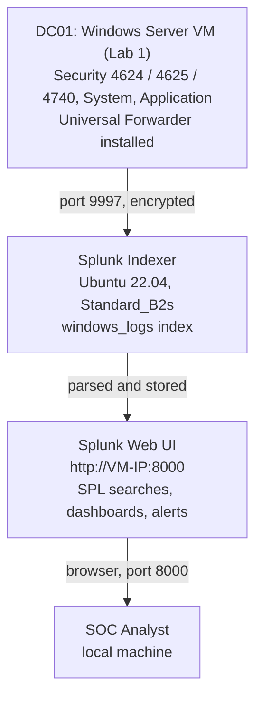

# Lab 3: Splunk SIEM and Log Analysis

 


## 🎥 Walkthrough

Follow along as I complete this lab! 

<Insert Loom Link>
 
## Table of Contents
 
- [Overview](#overview)
- [Business Context](#business-context)
- [Prerequisites](#prerequisites)
- [Hands-On Steps](#hands-on-steps)
- [Validation and Troubleshooting](#validation-and-troubleshooting)
- [Lessons Learned](#lessons-learned)
- [Vocabulary](#vocabulary)

## 📋 Overview

In this lab, the Windows Server virtual machine (DC01), configured as the domain controller, forwards its event logs to a separate Ubuntu virtual machine running Splunk Enterprise. Splunk indexes the incoming events and makes them searchable through its web interface. Using this interface, I developed search queries, created a monitoring dashboard, and configured an automated alert to detect relevant events.

| Skill | Real-world application |
|---|---|
| Deploy Splunk and configure a data input | Every Splunk deployment starts with getting data in. The Universal Forwarder is how most enterprises feed logs to Splunk. |
| Navigate the Splunk interface | Search, dashboards, alerts, and reports are table stakes for any SOC role. |
| Write SPL searches | SPL is how you ask Splunk questions, and it separates analysts who find threats from analysts who stare at dashboards. |
| Build security dashboards | Visualize login failures over time, top source IPs, and failed authentication by user at a glance. |
| Identify failed login attempts | One of the most common investigations: telling normal user error from a brute force attack. |
| Build an automated alert | Splunk fires an alert when your conditions are met instead of waiting for a human to notice. |
| Search for account lockout events | A trail of lockouts can indicate a password spray attack in progress. |

> Forward Windows Event Logs from an Active Directory domain controller into Splunk, then search, visualize, and alert on them the way a SOC analyst would.
 
## 🧩 Architecture
 

 
**NSG rules:** port 22 (SSH) and port 8000 (web UI) open to my IP only; port 9997 (forwarder) open to the VNet only.
 
### What You Will Learn
 

 
## 🎯 Business Context

A medium-sized organization generates millions of log events every day: Windows Event Logs from workstations, authentication logs from Active Directory, firewall logs, web server access logs, and cloud resource logs. Without a SIEM, those logs sit in separate systems and nobody can search across them, correlate events, or identify patterns that indicate an attack.
 
The SIEM is the security operations center's primary tool. When an alert fires, the SOC analyst opens the SIEM to understand what happened, when, from where, and what was affected. Splunk is the most widely deployed commercial SIEM, so learning it in a free lab gives a concrete, demonstrable skill that appears on job descriptions for almost every security operations role.
 
| Role | How this lab applies |
|---|---|
| SOC Analyst Tier 1 | Monitoring dashboards for alerts, searching logs for suspicious activity, escalating findings |
| SOC Analyst Tier 2-3 | Building detection rules, correlating events across data sources, threat hunting |
| Cloud Security Engineer | Microsoft Sentinel and AWS Security Hub use the same SIEM concepts, and this lab teaches the mental model |
| Incident Responder | Searching logs during an active incident, building a timeline of events, identifying scope of compromise |
 
## ✅ Prerequisites
 
## Prerequisites

<details>
<summary><b>1. Deploy the Ubuntu VM</b></summary>

In the Azure portal, search **Virtual machines**, click **Create**, and use these settings:

| Setting | Value |
|---|---|
| OS | Ubuntu 22.04 LTS (free tier eligible) |
| Size | Standard_B2s (2 vCPU, 4 GB RAM minimum; Splunk requires at least 4 GB) |
| Disk | 30 GB minimum |
| Inbound NSG ports | 8000 (Splunk web UI), 9997 (forwarder input), 22 (SSH) |

Open ports **8000** and **22** to **my IP address only**. Open port **9997** to the **VNet address range only** (10.0.0.0/16 or similar) so only my other Azure VMs can send logs to it, not the public internet.

</details>

<details>
<summary><b>2. Deploy the Windows VM</b></summary>

This is the same Windows Server VM built in Lab 1, which becomes DC01 and the log source for this lab.

1. Go to [azure.microsoft.com/free](https://azure.microsoft.com/free) and create a free account
2. Sign in to [portal.azure.com](https://portal.azure.com)
3. Search **Virtual machines** and click **Create**
4. Use the settings below
5. Click **Review + Create**, then **Create**

| Setting | Value |
|---|---|
| Region | East US |
| Image | Windows Server 2025 Datacenter, Gen2 |
| Size | Standard_B2s (2 vCPU, 4 GB RAM) |
| Authentication | Password |
| Public inbound ports | Allow RDP (3389) |
| OS disk | Standard SSD |

> **Tip:** Stop the VM when not in use. A B2s VM costs roughly $0.05/hour, and stopping (not deleting) pauses compute billing so the $200 free credit lasts much longer.

**Enable copy and paste over RDP.** Download the RDP file from the Azure portal (**Connect → Download RDP File**) and open it with the native Remote Desktop app. Before connecting, click **Show Options → Local Resources** and make sure **Clipboard** is checked. The browser-based console has very limited clipboard sharing.

</details>

<details>
<summary><b>3. SSH into the Linux VM</b></summary>

**Mac or Linux** (SSH is built in). Open Terminal.

Fix the key file permissions first, or SSH refuses to connect with an `UNPROTECTED PRIVATE KEY FILE` warning:

```bash
cd ~/Downloads
chmod 400 yourkey.pem
```

Then connect:

```bash
ssh -i yourkey.pem <admin-username>@<YOUR_VM_PUBLIC_IP>
```

Replace `<admin-username>` with the admin username set when creating the VM and `<YOUR_VM_PUBLIC_IP>` with the public IP from the Azure portal. Type `yes` at the host fingerprint prompt.

**Windows** (PuTTY). Windows 10/11 also include an OpenSSH client, so the command above works in PowerShell too.

1. Download the 64-bit Windows installer (.msi) from the [official PuTTY site](https://www.chiark.greenend.org.uk/~sgtatham/putty/latest.html)
2. Run the installer as Administrator with the default options
3. Open PuTTY and enter the VM's public IP in **Host Name**, with **Port 22** and **Connection type SSH** (the defaults)
4. Click **Open** and accept the host key security alert the first time
5. Type the VM admin username and press Enter, then type the password and press Enter

> Nothing appears on screen while typing a password in PuTTY, not even dots. This is normal Linux behavior. These steps assume password authentication. To use a `.pem` key with PuTTY, convert it with PuTTYgen first.

</details>

<details>
<summary><b>4. Install and start Splunk (Commands 1-4)</b></summary>

Run these inside the SSH session, in order.

**Command 1: Download the installer.** `wget` downloads a file, and `-O` sets the output filename.

```bash
wget -O splunk-10.2.2-linux-amd64.deb "https://download.splunk.com/products/splunk/releases/10.2.2/linux/splunk-10.2.2-80b90d638de6-linux-amd64.deb"
```

If this returns a 404, Splunk has released a newer version. Log into splunk.com, go to **Free Trials and Downloads**, select Linux `.deb`, and copy the `wget` command shown there.

**Command 2: Install the package.** `dpkg -i` installs the package into `/opt/splunk/`. A warning about a missing Python 3.7 path is expected and harmless on Ubuntu 22.04.

```bash
sudo dpkg -i splunk-10.2.2-linux-amd64.deb
```

**Command 3: Start Splunk and accept the license.** `--run-as-root` is required on newer Splunk versions when running as root. You will be prompted to create an admin username and password for the web UI.

```bash
sudo /opt/splunk/bin/splunk start --accept-license --run-as-root
```

**Command 4: Enable start on boot.** Registers Splunk as a service so it restarts automatically with the VM.

```bash
sudo /opt/splunk/bin/splunk enable boot-start
```

</details>

<details>
<summary><b>5. Access the web UI</b></summary>

Open this in a browser on the local machine, using the public IP from the VM's **Overview** page in the Azure portal:

```text
http://<YOUR_VM_PUBLIC_IP>:8000
```

</details>
 
#### If the browser shows "This site can't be reached"
 
A timeout on port 8000 is almost always a missing NSG rule. Work through these checks in order.
 
**Check 1: Add the port 8000 NSG rule (most common cause).**
 
1. Go to portal.azure.com → your Splunk VM → **Networking → Inbound port rules**
2. If no rule allows port 8000, click **Add inbound port rule** and set:
| Field | Value |
|---|---|
| Name | Allow-SplunkWebUI-MyIP |
| Source | My IP address |
| Destination port | 8000 |
| Protocol | TCP |
| Action | Allow |
| Priority | 310 |
 
3. Save the rule and try the browser again
**Check 2: Confirm Splunk is running.**
 
```bash
sudo /opt/splunk/bin/splunk status
# Expected: splunkd is running
```
 
If it says stopped, run the start command again:
 
```bash
sudo /opt/splunk/bin/splunk start --accept-license --run-as-root
```
 
**Check 3: Confirm Splunk is listening on port 8000.**
 
```bash
sudo ss -tlnp | grep 8000
# Expected: a line showing 0.0.0.0:8000 with splunkd in the process column
```
 
If nothing returns, Splunk is not running. If the line shows, Splunk is up and the issue is the NSG rule from Check 1.
 
**Check 4: Confirm the correct public IP.** Azure reassigns public IPs when a VM is stopped and restarted, so always get the current IP from **VM → Overview**. To stop it changing, go to **VM → Public IP address → Configuration** and set **Assignment** from Dynamic to **Static**.
 
**Check 5: Add the port 9997 inbound rule for the forwarder.** If the VMs are in different VNets or subnets, forwarder traffic is blocked by default. Find the Windows VM's private IP (10.x.x.x) on its Overview page, then on the Splunk VM go to **Networking → Inbound port rules → Add inbound port rule**:
 
| Field | Value |
|---|---|
| Name | Allow-SplunkForwarder-WindowsVM |
| Source | IP Addresses |
| Source IP | Windows VM private IP |
| Destination port | 9997 |
| Protocol | TCP |
| Action | Allow |
| Priority | 320 |
 
**Check 6: Set up VNet Peering if the VMs are in different VNets.** Even with NSG rules, VMs in separate VNets cannot talk without peering.
 
1. Go to portal.azure.com → **Virtual Networks** → the Splunk VM's VNet
2. Click **Peerings → Add**
3. Name the links: this VNet link `splunk-vnet-to-ad-vnet`, remote VNet link `ad-vnet-to-splunk-vnet`
4. Under **Remote virtual network**, select the Windows VM's VNet, leave other settings default, and click **Add**
5. Azure creates both directions; wait until both show **Connected**
6. On the Windows VM, restart the forwarder in an Administrator PowerShell:
```powershell
Restart-Service SplunkForwarder
```
 
> **Best practice:** Put all lab VMs in one shared VNet from the start (for example `lab-vnet`, 10.0.0.0/16) with a subnet per environment (10.0.1.0/24 for AD, 10.0.2.0/24 for Splunk). The VMs then communicate freely, NSG rules are managed at the subnet level, and no peering is needed.
 
</details>

 ## 🛠️ Steps

### Step 2: Configure Data Inputs
 
Splunk is only as useful as the data it receives. The first data source is the Active Directory / Windows Server VM from Lab 1.
 
#### Part A: Enable receiving in Splunk
 
Run this on the Splunk web UI (`http://<YOUR_VM_PUBLIC_IP>:8000`) before installing the forwarder.
 
1. Log into the Splunk web UI
2. Click **Settings → Forwarding and Receiving**
3. Click **Configure Receiving → New Receiving Port**, enter `9997`, and click **Save**
4. Click **Settings → Indexes → Create New Index**, name it `windows_logs`, and click **Save**
#### Part B: Install the Universal Forwarder on the Windows Server VM
 
Do this on the **Windows Server VM**, not the Ubuntu VM.
 
1. On the Windows VM, open a browser and go to [splunk.com/en_us/download/universal-forwarder.html](https://www.splunk.com/en_us/download/universal-forwarder.html), and log in with the same Splunk account used for the Enterprise download
2. Download the **Windows 64-bit** `.msi` installer (the page also lists 32-bit and ARM versions)
3. Run the installer and work through the screens:
| Screen | What to enter |
|---|---|
| Default Installation Options | Check the license box and select **An on-premises Splunk Enterprise instance**. Do **not** select Splunk Cloud, because that skips the Receiving Indexer screen and the forwarder has nowhere to send data. |
| Administrator credentials | Username `admin`, uncheck **Generate random password**, set a password and save it for CLI commands later |
| Deployment Server | **Leave completely blank.** Entering the Splunk VM IP here makes the forwarder phone home to the wrong address and no data flows. |
| Receiving Indexer | The Splunk VM's **private IP** and port **9997** (for example `10.2.0.4:9997`) |
 
4. Click **Install** (about 30 seconds), then **Finish**
#### Part C: Configure `inputs.conf`
 
`inputs.conf` tells the forwarder which Windows Event Logs to collect. The path must be exact:
 
```text
C:\Program Files\SplunkUniversalForwarder\etc\system\local\inputs.conf
```
 
Visual Studio Code is the easiest editor for this. Install it on the Windows VM from [code.visualstudio.com](https://code.visualstudio.com), then right-click the shortcut and choose **Run as Administrator** so it can save into Program Files. Create the `local` folder in Windows Explorer first if it does not exist, open it in VS Code with **File → Open Folder**, create a file named `inputs.conf`, paste the configuration below, and save with `Ctrl+S`.
 
```ini
# Each section in square brackets defines one log source to collect
 
[WinEventLog://Security]
# Authentication events: logins, failures, lockouts
disabled = 0
# Collect historical events, not just new ones
start_from = oldest
current_only = 0
# Resolve Active Directory object names so usernames appear instead of SIDs
evt_resolve_ad_obj = 1
# Required: without this line data goes to the main index, not windows_logs
index = windows_logs
 
[WinEventLog://System]
# OS-level events: service starts and stops, driver failures
disabled = 0
index = windows_logs
 
[WinEventLog://Application]
# Events from installed applications
disabled = 0
index = windows_logs
```
 
Restart the forwarder to apply the changes (Administrator PowerShell on the Windows VM):
 
```powershell
Restart-Service SplunkForwarder
```
 
> Splunk also ships with built-in sample data (**Search → Data Summary**), which can be used for most search exercises while Lab 1 is still being built.
 
<!-- Add screenshot: Settings > Forwarding and Receiving showing port 9997 enabled -->
 
#### Part D: Generate test log data
 
A fresh Windows Server VM has mostly empty logs, so generate activity before running the searches. The script creates a temporary local user (`labtest.user`), generates failed and successful logins, service restarts, application events, and an account lockout, then deletes the user. It only creates events in the Windows Event Log; nothing is changed permanently.
 
Open **PowerShell as Administrator** on the Windows VM and run the whole script (about 60-90 seconds).
 
<details>
<summary><b>Click to expand: log generator script</b></summary>
```powershell
# Lab 3 Log Generator - run as Administrator on the Windows VM
# Output saved to C:\lab3-log-output.txt
# Lab-only throwaway credentials; the test account is deleted at the end
 
$logFile = 'C:\lab3-log-output.txt'
$timestamp = Get-Date -Format 'yyyy-MM-dd HH:mm:ss'
 
function Log($message, $color = 'White') {
    Write-Host $message -ForegroundColor $color
    Add-Content -Path $logFile -Value "[$timestamp] $message"
}
 
# Clear any previous run output
if (Test-Path $logFile) { Remove-Item $logFile }
Add-Content -Path $logFile -Value "Lab 3 Log Generator - Run started at $timestamp"
Add-Content -Path $logFile -Value '============================================='
Log 'Starting log generation...' Green
 
# Create a temporary test user account
$testUser = 'labtest.user'
$testPass = ConvertTo-SecureString 'TempPass123!' -AsPlainText -Force
New-LocalUser -Name $testUser -Password $testPass -Description 'Splunk lab test account' -ErrorAction SilentlyContinue
Log "Created test user: $testUser" Gray
 
# Failed logon attempts (Security log activity)
Log 'Generating failed logon attempts (Security log activity)...' Yellow
$wrongPass = ConvertTo-SecureString 'WrongPassword!' -AsPlainText -Force
1..15 | ForEach-Object {
    $cred = New-Object System.Management.Automation.PSCredential($testUser, $wrongPass)
    Start-Process -FilePath 'cmd.exe' -Credential $cred -ArgumentList '/c exit' -ErrorAction SilentlyContinue
    Start-Sleep -Milliseconds 500
}
Log '  Generated 15 failed logon attempts' Gray
 
# Successful login (Event ID 4624)
Log 'Generating successful login event (4624)...' Yellow
$correctPass = ConvertTo-SecureString 'TempPass123!' -AsPlainText -Force
$cred = New-Object System.Management.Automation.PSCredential($testUser, $correctPass)
Start-Process -FilePath 'cmd.exe' -Credential $cred -ArgumentList '/c whoami' -Wait -ErrorAction SilentlyContinue
Log '  Generated successful login (Event ID 4624)' Gray
 
# Service start/stop events (Event ID 7036)
Log 'Generating service events (7036)...' Yellow
$services = @('Spooler', 'Schedule', 'Netlogon')
$services | ForEach-Object {
    Stop-Service -Name $_ -Force -ErrorAction SilentlyContinue
    Start-Sleep -Seconds 2
    Start-Service -Name $_ -ErrorAction SilentlyContinue
    Start-Sleep -Seconds 1
    Log "  Stopped and restarted service: $_" Gray
}
 
# Application log entries
Log 'Generating application log events...' Yellow
$eventSource = 'SplunkLabTest'
if (-not [System.Diagnostics.EventLog]::SourceExists($eventSource)) {
    New-EventLog -LogName Application -Source $eventSource -ErrorAction SilentlyContinue
}
1..5 | ForEach-Object {
    Write-EventLog -LogName Application -Source $eventSource -EventId 1001 `
        -EntryType Warning -Message 'Splunk lab test event - application warning'
    Start-Sleep -Milliseconds 300
}
Log '  Generated 5 application log entries (Event ID 1001)' Gray
 
# Lock out the test account (Event ID 4740)
Log 'Generating account lockout event (4740)...' Yellow
$badCred = ConvertTo-SecureString 'BadPass!' -AsPlainText -Force
1..20 | ForEach-Object {
    $cred = New-Object System.Management.Automation.PSCredential($testUser, $badCred)
    Start-Process -FilePath 'cmd.exe' -Credential $cred -ArgumentList '/c exit' -ErrorAction SilentlyContinue
    Start-Sleep -Milliseconds 200
}
Log '  Account lockout triggered (Event ID 4740)' Gray
 
# Clean up the test account
Start-Sleep -Seconds 3
Remove-LocalUser -Name $testUser -ErrorAction SilentlyContinue
Log "Removed test user: $testUser" Gray
 
# Restart the forwarder to ship events to Splunk
Log 'Restarting forwarder to ship events to Splunk...' Yellow
Restart-Service SplunkForwarder -ErrorAction SilentlyContinue
Log '  SplunkForwarder restarted' Gray
 
$endTime = Get-Date -Format 'yyyy-MM-dd HH:mm:ss'
Add-Content -Path $logFile -Value '============================================='
Add-Content -Path $logFile -Value "Run completed at $endTime"
Add-Content -Path $logFile -Value 'Wait 60 seconds then run: index=windows_logs | head 100'
 
Write-Host ''
Write-Host '=============================================' -ForegroundColor Green
Write-Host 'Done. Output saved to C:\lab3-log-output.txt' -ForegroundColor Green
Write-Host 'Wait 60 seconds then search Splunk.' -ForegroundColor Green
Write-Host '=============================================' -ForegroundColor Green
```
 
</details>
Wait 60 seconds for the forwarder to ship the events. Then set the Splunk time range to **All Time** and run `index=windows_logs | head 100`. Events from the Security, System, and Application logs mean the lab is ready for Step 3.
 
### Step 3: Essential SPL Searches
 
Type searches into the **Search & Reporting** bar and choose a time range with the time picker on the right.
 
**Confirm data is flowing**
 
```spl
index=windows_logs | head 100
```
 
- `index=windows_logs` searches only the index created in Step 2
- `| head 100` returns the first 100 events
- If this returns nothing, check that the `SplunkForwarder` service is running on the Windows VM
**Find successful logins (EventCode 4624)**
 
```spl
index=windows_logs sourcetype=WinEventLog:Security EventCode=4624
| stats count by Account_Name
| sort -count
```
 
Counts successful logons per account, highest first.
 
**Detect after-hours logins**
 
```spl
index=windows_logs sourcetype=WinEventLog:Security EventCode=4624
| eval hour=strftime(_time, "%H")
| where hour < 7 OR hour > 19
| table _time, Account_Name, Account_Domain, ComputerName
| sort -_time
```
 
- `eval hour=strftime(_time, "%H")` extracts the hour from each timestamp
- `where hour < 7 OR hour > 19` keeps only events outside 7 am-7 pm
- Account names ending in `$` are computer accounts, which are normal and expected
- Human account names (no `$`) logging in after hours warrant review
<!-- Add screenshot: after-hours logins search results -->
 
### Step 4: Build a Security Dashboard
 
Dashboards give a permanent view of security posture without rerunning searches.
 
1. In Splunk, click **Dashboards** in the top navigation
2. Click **Create New Dashboard** (top right)
3. Set **Dashboard Title** to `Windows Security Overview`, leave **Description** blank, leave **Permissions** as Private, select **Classic Dashboards**, then click **Create** and **Create Dashboard**
4. Click **Add Panel** for each panel below, choose **New Search**, paste the search, pick the visualization, and save
| Panel | Visualization |
|---|---|
| Account Activity (last 24h) | Bar chart |
| Top Processes (last 24h) | Events list |
| Login Activity Over Time | Line chart |
| After-Hours Logins | Events list |
 
**Account Activity**
 
```spl
index=windows_logs sourcetype=WinEventLog:Security EventCode=4624
| stats count by Account_Name
| sort -count
```
 
**Top Processes**
 
```spl
index=windows_logs sourcetype=WinEventLog:Security EventCode=4688
| stats count by Creator_Process_Name
| sort -count
| head 20
```
 
**Login Activity Over Time**
 
```spl
index=windows_logs sourcetype=WinEventLog:Security EventCode=4624
| timechart count
```
 
**After-Hours Logins**
 
```spl
index=windows_logs sourcetype=WinEventLog:Security EventCode=4624
| eval hour=strftime(_time, "%H")
| where hour < 7 OR hour > 19
| table _time, Account_Name, Account_Domain, ComputerName
| sort -_time
```
 
> Panels depend on the event types present in the index, so some (such as process creation, 4688) can be empty on a fresh VM.
 
<!-- Add screenshot: Windows Security Overview dashboard with populated panels -->
 
### Step 5: Create an Automated Alert
 
Alerts automate detection: Splunk runs a search on a schedule and notifies when conditions are met. First run this search to confirm it works:
 
```spl
index=windows_logs sourcetype=WinEventLog:Security EventCode=4672
| stats count as privilege_logons by Account_Name, ComputerName
| where privilege_logons > 50
```
 
This finds any account with more than 50 privileged logon events. EventCode 4672 fires when admin-level rights are assigned at logon. Then:
 
1. Click **Save As → Alert**
2. **Name:** `High Privileged Logon Count`
3. **Alert type:** Scheduled
4. **Run every:** 15 minutes, using **Cron Schedule** with `*/15 * * * *`
5. **Trigger condition:** Number of Results is greater than 0
6. **Trigger actions:** Add to Triggered Alerts. This logs each firing, with a timestamp and result count, to **Activity → Triggered Alerts**, and needs no email or ticketing integration.
7. Click **Save**
> Alert quality drives monitoring quality. An alert that fires too broadly causes alert fatigue, and one that is too narrow misses real threats. The threshold of 50 is a starting point; in a real environment it would be tuned over time based on false positives.
 
<!-- Add screenshot: alert configuration page -->
 
## Validation and Troubleshooting
 
### Validation
 
| Check | How to verify |
|---|---|
| Data is flowing into Splunk | Run `index=windows_logs \| head 10`, which should return recent events |
| Login activity search works | Run the EventCode 4624 search, which should return results immediately because the Windows VM generates logon events continuously |
| Dashboard displays data | The Windows Security Overview dashboard shows populated panels with charts |
| Alert is active | **Settings → Searches, Reports, and Alerts** lists the alert as Enabled |
 
### Troubleshooting
 
| Problem | Fix |
|---|---|
| Web UI shows "This site can't be reached" | Work through the six checks under [Prerequisites](#5-access-the-web-ui): NSG rule for port 8000, Splunk status, listening port, current public IP, port 9997 rule, VNet peering |
| Public IP changed after a VM restart | Get the current IP from **VM → Overview**, and set the public IP assignment to **Static** to prevent it |
| `index=windows_logs` returns nothing | Set the time range to **All Time** and confirm the `SplunkForwarder` service is running on the Windows VM. Restart it with `Restart-Service SplunkForwarder`. |
| Forwarder is installed but no data arrives | Confirm receiving is enabled on port 9997, the **Deployment Server** field was left blank, the **Receiving Indexer** is the Splunk VM's private IP and port 9997, and the installer used the on-premises option |
| Events land in `main` instead of `windows_logs` | `inputs.conf` is missing `index = windows_logs` under each stanza. Add it and restart the forwarder. |
| Cannot save `inputs.conf` | Run VS Code as Administrator so it can write into Program Files |
| Forwarder cannot reach the indexer across VNets | Add the port 9997 NSG rule and VNet peering (Checks 5 and 6), then restart the forwarder |
| SSH fails with `UNPROTECTED PRIVATE KEY FILE` | Run `chmod 400 yourkey.pem` before connecting |
| `splunk start` fails with a deprecation error | Add `--run-as-root` to the start command |
| `wget` returns 404 | Splunk released a newer version; copy the current `wget` command from the Splunk download page |
| Cannot paste commands into the Windows VM | Use the downloaded RDP file in the native Remote Desktop app and enable Clipboard under **Local Resources** |
 
## Lessons Learned
 
- **A missing NSG rule is the first suspect for a connection timeout.** Port 8000 for the web UI and port 9997 for the forwarder both need explicit rules.
- **Scope network exposure tightly.** SSH and the web UI are limited to my IP, and the forwarder port is limited to the VNet.
- **Azure public IPs change when a VM is stopped and restarted.** Setting the assignment to Static avoids chasing a new IP every session.
- **Put all lab VMs in one VNet with a subnet per environment.** It avoids VNet peering and keeps NSG management simple.
- **Leave the Deployment Server blank in the Universal Forwarder installer.** Pointing it at the Splunk VM sends the forwarder to the wrong place and no data flows.
- **Every `inputs.conf` stanza needs its `index` setting.** Without it, events go to the default `main` index and searches against `windows_logs` come back empty.
- **A fresh VM has little to detect.** Generating test activity (failed logons, a lockout, service restarts) is what makes searches, dashboards, and alerts demonstrable.
- **Alert thresholds need tuning.** Too broad causes alert fatigue, too narrow misses threats, so start with a baseline and adjust on false positives.
- **Stop VMs between sessions** to preserve free-tier credit.
## Vocabulary
 
| Term | Definition |
|---|---|
| **SIEM** (Security Information and Event Management) | A platform that collects logs from servers, workstations, firewalls, cloud services, and apps into one searchable place. Its two core jobs are correlation and alerting. |
| **Correlation** | Connecting events across different systems to identify patterns that no single system would reveal alone |
| **SPL** (Splunk Processing Language) | Splunk's query language, built as a pipeline: find the events, then pipe them through commands that filter, transform, and visualize |
| **Index** | A named storage bucket for events, similar to a database table. Separate indexes allow separate retention, permissions, and storage per data source. This lab uses `windows_logs`. |
| **Indexer** | The Splunk component that receives, parses, and stores incoming events (here, the Ubuntu VM) |
| **Universal Forwarder** | A free, lightweight Splunk agent that compresses, encrypts, and sends logs to the indexer over port 9997 |
| **`inputs.conf`** | Config file on the forwarder machine that defines which data sources to collect. Each `[bracketed]` section is one source. |
| **NSG** (Network Security Group) | Azure firewall rules that control inbound and outbound traffic to a VM |
| **VNet Peering** | A direct private connection between two Azure virtual networks, required for VMs in separate VNets to communicate |
| **Alert fatigue** | Analysts ignoring alerts because too many fire, often from poorly tuned thresholds |
 
### Windows Event IDs used in this lab
 
| EventCode | Meaning | Why it matters |
|---|---|---|
| **4624** | Successful logon (logon type shows interactive, remote, or service) | Baseline authentication activity and after-hours detection |
| **4625** | Failed logon | Brute force and password spray detection |
| **4672** | Special privileges assigned to a new logon | Privileged account activity |
| **4688** | New process created | Threat hunting for malicious execution |
| **4740** | Account locked out | A trail of lockouts can indicate a password spray |
| **7036** | Service entered a running or stopped state | Service start and stop activity |


